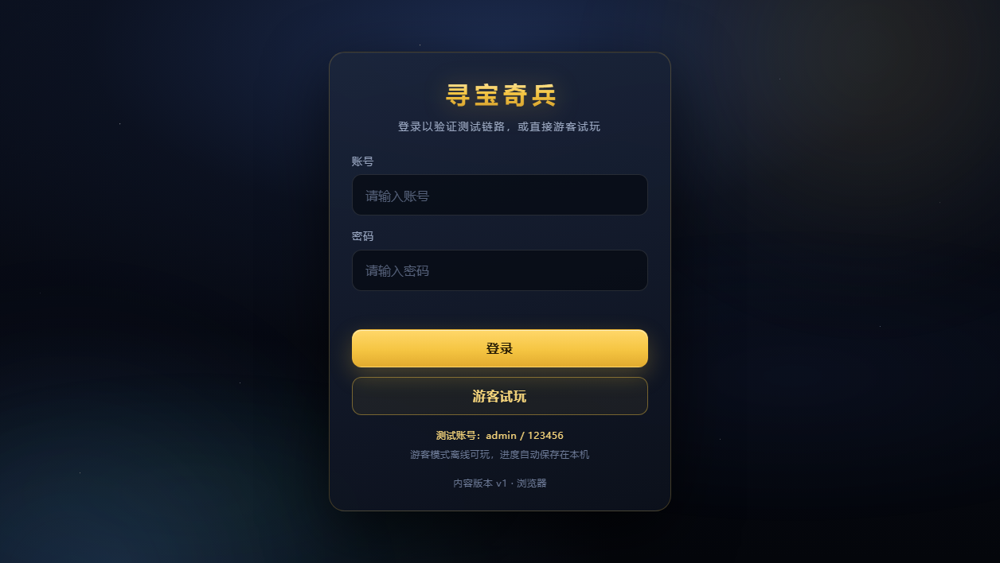
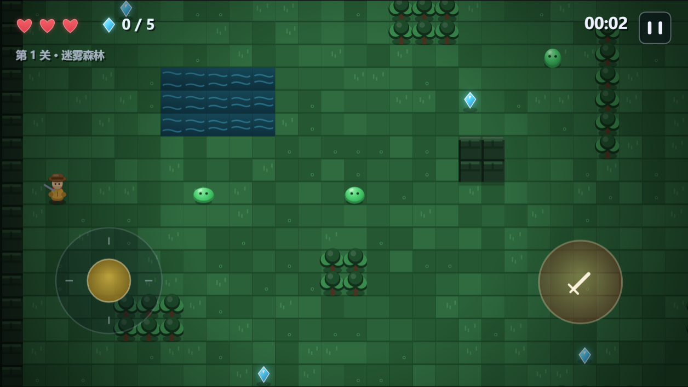
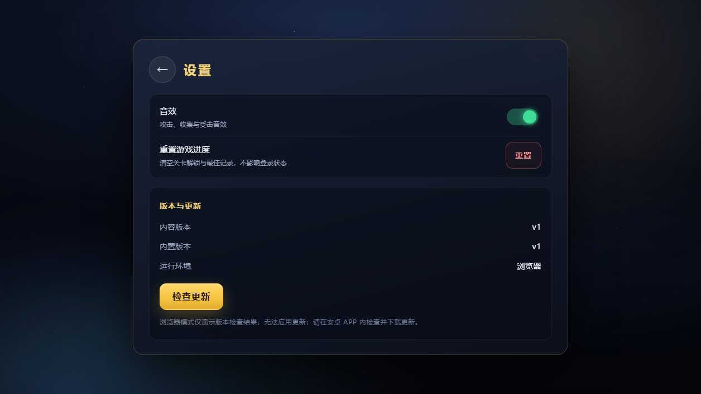

# 寻宝奇兵 · Treasure Quest

> 一款「闯关 + 探险 + 收集宝藏」的 2D 安卓游戏，完整演示 **开发 → 本地测试 → 打 APK → 服务器发布 → APP 内内容 OTA 热更新** 的独立游戏管线。

[](https://github.com/tangjinchun/treasure-quest/actions/workflows/ci.yml)
[](LICENSE)


**手机实测**：小米 15 Pro（Android 16），侧载安装、登录、触屏游玩正常。

| 登录页 | 游戏画面 | 设置 / 更新 |
|---|---|---|
|  |  |  |

## 🎮 在线体验 / 下载

| 方式 | 地址 | 说明 |
|---|---|---|
| 网页试玩 | `https://tangjinchun.github.io/treasure-quest/`（GitHub Pages） | 游客模式可离线试玩；登录/OTA 需要自建后端 |
| 安卓 APK | `https://zzysjqr.cn/treasure/apk/treasure-quest-0.1.0-debug.apk` | 作者演示服（可能关闭）；debug 签名，仅测试用 |

> 演示服为作者自建测试服务器，随时可能关闭；想长期运行请看 [部署文档](docs/DEPLOY.md)。

## ✨ 特性

- **2D 俯视角冒险**：4 个关卡（迷雾森林 / 幽暗洞窟 / 失落神殿 / 云端秘殿），瓦片地图 + 相机跟随
- **完整玩法循环**：收集宝石 → 钥匙开门 → 传送门通关 → 结算/最佳用时/存档解锁
- **战斗与机关**：剑击、史莱姆/蝙蝠/幽灵三种敌人、尖刺陷阱、回血道具、受伤无敌帧、粒子与屏幕震动
- **移动端体验**：横屏、虚拟摇杆 + 攻击键、触屏暂停；桌面浏览器支持 WASD/方向键 + J/空格
- **登录与存档**：测试账号 + 游客离线模式；本地存档 `localStorage`，支持老存档跨版本迁移
- **内容 OTA 热更新**：APP 内检查更新 → 下载内容包 → sha256 校验 → 解压切换 → 重启生效，**无需重装 APK**
- **服务端**：Python 标准库零依赖后端（版本清单 / 登录 token / 静态下载 / 管理员统计），nginx 反代 + systemd 部署
- **工程质量**：37 个 Node 逻辑测试、37 个 Python 后端测试、Edge CDP 浏览器 UI 自动化、GitHub Actions CI

## 🧱 技术栈

| 层 | 技术 |
|---|---|
| 游戏本体 | 原生 JavaScript + Canvas 2D + WebAudio（无引擎、无构建、无外部素材，全部程序化绘制） |
| Android 壳 | Java 8，WebView + 自定义 OTA 管理器（无 AndroidX / 无第三方依赖），aapt2 + d8 + apksigner 手动构建 |
| 后端 | Python 3.11 标准库（`http.server`），HMAC token、限流、静态下载 |
| 部署 | Linux + systemd + nginx（反代，仅内网端口） |
| 测试 | Node `node:test`、Python `unittest`、Chrome DevTools Protocol 浏览器自动化 |

> 选择「H5 + WebView 壳」而非 Unity：内容 OTA 只需替换 web 资源包，不重装 APK；同一份代码浏览器可直接测试；无商业引擎依赖、体积极小（APK ≈ 158KB）。

## 🏗 架构

```
┌─────────────── 手机 APP（Android WebView 壳）───────────────┐
│  MainActivity ── WebView（https://app.local，本地拦截）      │
│        │              ├── 已下载内容 files/web/<版本>/       │
│        │              └── 内置资源 assets/web/              │
│  TQBridge（JS ↔ Java）                                      │
│  OtaManager：检查版本 → 下载 zip → sha256 → 解压 → 切换      │
└──────────────────────────┬──────────────────────────────────┘
                           │ HTTPS
┌──────────────────────────▼──────────────────────────────────┐
│  nginx（现有入口）/treasure/ → 本地 3001                      │
│  Python 后端：/api/version  /api/login  /updates/*.zip       │
│               /apk/*.apk   /api/stats                        │
│  数据：versions.json（热读取）、users.json、内容包、APK       │
└─────────────────────────────────────────────────────────────┘
```

### 内容 OTA 流程

1. 本地修改 `web/`，把 `web/version.json` 的 `contentVersion` 递增
2. `python tools/build_web.py --version N` → 内容 zip + sha256 + manifest
3. `python tools/publish_content.py --version N` → SFTP 上传 + 原子更新 `versions.json`
4. 手机 APP 设置页点「检查更新」→ 弹出更新说明 → 下载 → 校验 → 解压
5. 重启 WebView 生效（保留上一版本用于失败回退），全程无需重装 APK

## 📁 目录

| 路径 | 说明 |
|---|---|
| `web/` | H5 游戏本体（无构建、无外部依赖） |
| `android/` | Android WebView 壳 + 内容 OTA 管理器（Java） |
| `server/` | Python 后端（版本清单 / 登录 / 内容包与 APK 下载） |
| `tools/` | 本地开发、内容构建、APK 构建、部署、发布、OTA 模拟脚本 |
| `tests/` | 游戏逻辑自动化测试 |
| `docs/` | 架构 / API / OTA / 游戏设计 / 安装 / 构建 / 部署 / 运维 / 测试计划 |
| `dist/` | 构建产物（内容包、APK，不进仓库） |

## 🚀 快速开始（本地）

```bash
# 1) 本地后端（Python 3.11+，默认 127.0.0.1:3001）
python server/server.py

# 2) 静态游戏服务（默认 127.0.0.1:5173）
python tools/dev_server.py
# 浏览器打开 http://127.0.0.1:5173/?api=http://127.0.0.1:3001
```

浏览器里可游客试玩；登录测试账号 `admin / 123456`（后端 `server/data/users.json` 中生成）。

## 📱 构建 APK

环境：JDK 17+、Android SDK（platform-tools / platforms;android-35 / build-tools;35.0.0）。

```bash
# 可选：首次安装 SDK（Windows，从 Google 官方仓库下载）
python tools/install_android_sdk.py

# 构建（aapt2 + javac + d8 + zipalign + apksigner，无需 Android Studio/Gradle）
python tools/build_apk.py
# 产物：dist/treasure-quest-<versionName>-debug.apk
```

安装：手机浏览器下载 APK → 允许安装未知来源 → 安装（测试用 debug 签名，正式发布请替换 release keystore）。

## 🌐 部署到自己的服务器

需要：一台 Linux 服务器（示例为腾讯云轻量）、nginx、Python 3.11、一个已解析的域名与 HTTPS 证书。本仓库文档用占位符 `<YOUR_SERVER_IP>`、`<YOUR_DOMAIN>`、`<USER>` 表示你自己的信息。

```bash
# 1) 服务器 root 执行一次（幂等）：创建系统用户/目录、systemd 服务、nginx include
#    上传 server/ 后执行 server/deploy/install.sh（详见 docs/DEPLOY.md）
# 2) 本地发布内容与 APK
python tools/build_web.py --version 1 --notes "首个版本"
python tools/publish_content.py --version 1 --notes "首个版本" --apk dist/treasure-quest-0.1.0-debug.apk
```

详见 [docs/DEPLOY.md](docs/DEPLOY.md) 与 [docs/RUNBOOK.md](docs/RUNBOOK.md)。

## 🧪 测试

```bash
node --test tests/game/                            # 37 个游戏逻辑/地图测试
python -m unittest discover -s server/tests -v     # 37 个后端接口测试
python tools/validate_web.py                       # web 资源完整性/JS 语法/体积
```

浏览器 UI 自动化（Edge CDP，本地已跑通 14 项）：见 `.tooling` 脚本说明与 [docs/TESTPLAN.md](docs/TESTPLAN.md)。

## 📚 文档

- [手机安装与验收](docs/INSTALL.md)
- [系统架构](docs/ARCH.md) ｜ [API 契约](docs/API.md) ｜ [OTA 契约](docs/OTA.md)
- [游戏设计与模块接口](docs/GAMEDESIGN.md)
- [构建与本地开发](docs/BUILD.md)
- [部署](docs/DEPLOY.md) ｜ [运维手册](docs/RUNBOOK.md)
- [测试计划](docs/TESTPLAN.md) ｜ [验证记录](docs/VERIFY.md)

## 🗺 路线图

- [x] v0.1.0：4 关闯关玩法、WebView 壳、内容 OTA、服务器发布、APK 侧载
- [ ] 用户体系（注册/登录/找回密码），替换测试账号
- [ ] 云存档与排行榜
- [ ] APK 整包自更新（下载后引导安装）
- [ ] 正式 release 签名、隐私政策、视频/音乐资源
- [ ] iOS / PWA 版本（同一套 H5 代码）

## ⚠️ 限制与免责

- 测试版：`admin / 123456` 仅为演示账号；正式使用前必须替换为完整用户体系并强制复杂密码。
- debug 签名 APK 仅用于个人测试分发，**不要对外发布**；正式发布需生成 release keystore 并妥善备份。
- 当前未申请软著/版号，不上架任何应用商店；仅供个人学习与测试。
- 演示服务器为作者自建测试服，可能随时关闭；请按文档部署到你自己的服务器。

## 📄 License

[MIT](LICENSE) © 2026 Tang Jinchun
