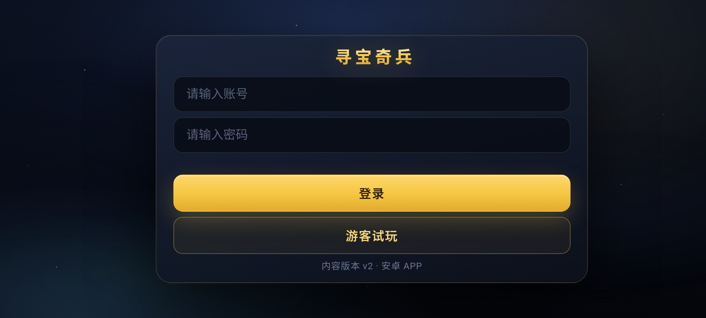

# 验证记录（Evidence Log）

> 记录 v0.1.0 的实际验证证据，便于复核。命令均可在仓库根目录复跑。

## 1. 自动化测试

| 测试 | 命令 | 结果 |
|---|---|---|
| 游戏逻辑/地图 | `node --test tests/game/` | **37/37 通过**（含第 4 关地图校验、锁门门槛、BFS 可达性、无头渲染玩法） |
| 后端 API | `python -m unittest discover -s server/tests -v` | **37/37 通过**（health/version/login/me/stats/静态下载/CORS/限流/路径穿越） |
| Web 静态校验 | `python tools/validate_web.py` | VALIDATE_WEB_OK（10 JS ≈ 256KB，无外链、脚本顺序正确） |
| 浏览器 UI 自动化 | Edge CDP（登录/游客/第 1 关/暂停/设置） | 14/14 通过，控制台/页面零错误 |
| v2 内容验收 | Edge CDP（4 关卡片/旧存档迁移/第 4 关可玩/版本 v2） | 通过（第 4 关运行、迁移 `unlockedLevel=3`、设置显示 v2） |
| 内容包构建 | `python tools/build_web.py --version 2` | `dist/treasure-content-2.zip`，14 文件，sha256 `68132d7a…` |
| APK 构建 | `python tools/build_apk.py` | `dist/treasure-quest-0.1.0-debug.apk`，≈158KB，package `cn.zzysjqr.treasurequest`，v1/0.1.0，minSdk 26 / target 35，debug 签名，`apksigner verify` 通过 |
| APK 内容检查 | unzip | `assets/web`（13 文件）、`classes.dex`、`resources.arsc`、图标齐全 |
| OTA 客户端模拟 | `python tools/ota_client_sim.py --api-base https://zzysjqr.cn/treasure --current-version 0` | OTA_APPLIED content v1：下载、sha256、解压、bundle 校验通过 |
| OTA 客户端模拟（v1→v2） | `... --current-version 1` | OTA_APPLIED content v2：sha256 `68132d7a…` 校验通过 |

## 2. 发布产物

| 项 | 值 |
|---|---|
| 内容版本 | v2（`contentVersion=2`，`minShellVersion=1`） |
| 内容包 | `updates/treasure-content-2.zip`（sha256 `68132d7a…`，71,219 B） |
| APK | `apk/treasure-quest-0.1.0-debug.apk`（161,492 B，debug 签名） |
| 登录测试 | `POST /treasure/api/login` admin/123456 → 200 + token + displayName |
| 下载统计 | `/api/stats` 可看到内容包/APK 下载与登录事件 |

## 3. 真机验证（用户）

| 项 | 结果 |
|---|---|
| 手机 | Xiaomi 15 Pro，Android 16 |
| 下载并侧载 APK | ✅ 成功 |
| 首次启动 + 登录 admin | ✅ 成功（服务器日志记录手机登录，14:16） |
| 触屏游玩体验 | ✅ 用户反馈「体验很棒」 |
| APP 内检查更新 → 下载 → 重启生效（v1→v2） | ✅ 已在 Android 15 模拟器完成全流程（见第 4 节）；用户手机可随时复验 |

## 4. 模拟器端 OTA 全流程实测（Android 15，真实 APK + 真实服务器）

为验证 Java 原生 OTA 管理器，在 Android 15（API 35，x86_64）模拟器上安装**只内置 v1 内容**的 APK，连接真实服务器 `https://zzysjqr.cn/treasure`，通过 WebView 远程调试调用 JS 桥驱动：

| 步骤 | 实测结果 |
|---|---|
| 启动 | `getState()`：`bundledContentVersion=1, contentVersion=1, contentDir=assets` |
| 检查更新 | 收到 `ota_available`：version=2、size=71219、notes 正确 |
| 下载 | `ota_progress` 11% → 100%，`received=71219` |
| 校验/解压 | `ota_progress` verify/unzip 各 100%，无错误 |
| 完成 | `ota_done`：contentVersion=2、restartRequired=true |
| 重启生效 | 重启 WebView 后 `getState()`：`contentVersion=2, contentDir=files/web/2, bundledContentVersion=1`；`TQ.Game.getLevelCount()=4` |
| 文件落盘 | `/data/data/cn.zzysjqr.treasurequest/files/ota/ota_state.json` = `{"contentVersion":2,"activeDir":"files/web/2","previousVersion":0}`；`files/web/2/` 内含 `bundle.json/index.html/js/css/version.json` |
| 服务端记录 | `/api/stats` 中 `treasure-content-2.zip` 下载次数增加（14:36 两次） |

截图（OTA 后登录页显示「内容版本 v2 · 安卓 APP」）：

> 说明：本次测试使用测试构建（`AppConfig.ENABLE_WEBVIEW_REMOTE_DEBUG=true` 便于自动化）；正式发布前把该常量改为 `false` 即可关闭 WebView 远程调试。

## 5. 开源发布

| 项 | 值 |
|---|---|
| GitHub 公共仓库 | `https://github.com/tangjinchun/treasure-quest` |
| 在线试玩（GitHub Pages） | `https://tangjinchun.github.io/treasure-quest/` |
| Release v0.1.0（含 APK） | `https://github.com/tangjinchun/treasure-quest/releases/tag/v0.1.0` |
| CI（游戏 + 后端测试） | GitHub Actions 通过 |
| Pages 部署 | GitHub Actions 通过，公网可访问且浏览器验收 14/14 通过（登录、游玩、设置） |
| License | MIT |

## 6. 说明

- 测试环境为作者自建服务器（详见 `docs/DEPLOY.md`；仓库中服务器 IP、SSH、内部服务信息已用占位符替换）。
- 手机安装/登录已由用户真机验证；APP 内 OTA 升级（v1→v2）已在 Android 15 模拟器完成端到端实测（见第 4 节），用户手机可随时复验。
- APK 为 debug 签名，仅用于个人测试分发。
